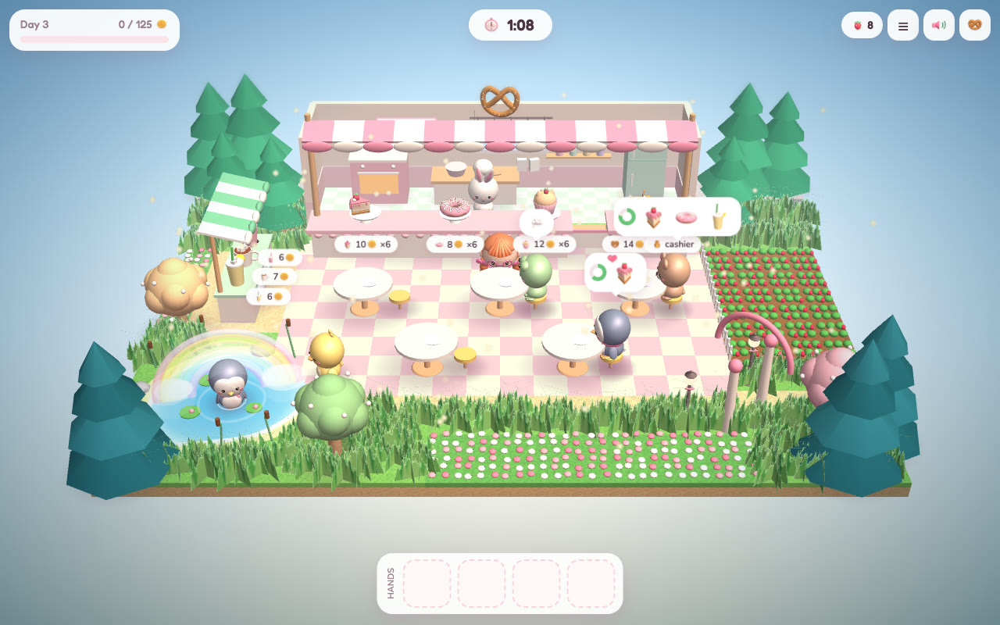
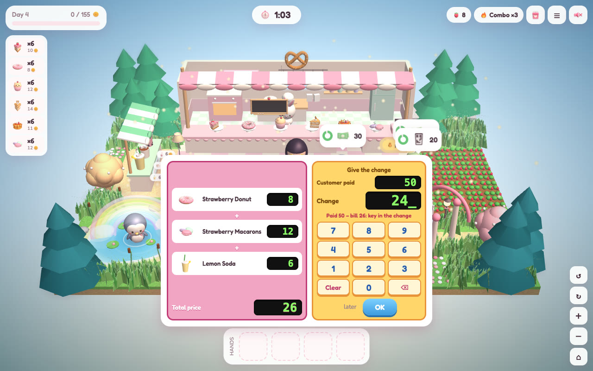
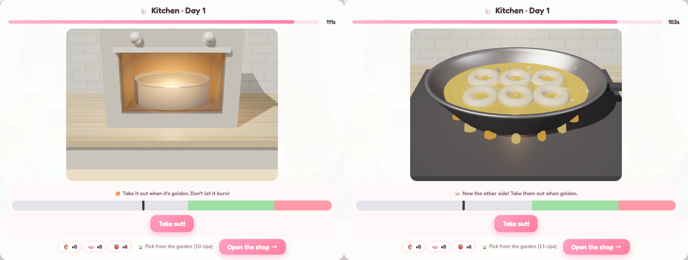
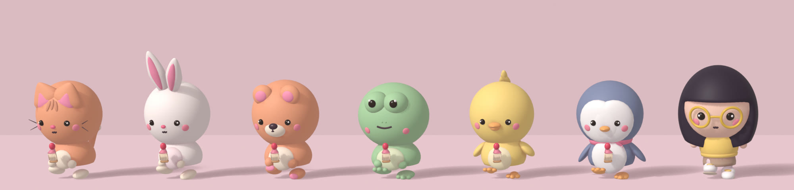

# 🥨 Miw's Town

A cozy, pastel 3D town that shows what your Claude Code agents are doing, live, plus a café game built on the same little characters.

Each Claude Code session moves in as a character. It walks to the Library when it reads files, sits in the Writing Studio when it edits, and ends up at the Bug Clinic when something fails. When it's done it heads home to rest, swim or grab a pretzel.


## What's inside

| Page | What it is |
|---|---|
| **Town** (`/town`) | A floating island with one building per state, a pool, a café, waterfalls and the 🐱 Cat Home |
| **Cat Room** (`/room`) | The same agents indoors: living room, kitchen, bathroom, bedroom and a plant balcony |
| **Cheesecake Rush** (`/game`) | A café game: bake, serve and give change (see below) |

Two halves share the same characters: the **agent town** (Town and Cat Room, below) shows your Claude Code agents live, and **Cheesecake Rush** is a game you can [play on its own](#play-it).

## Watch your agents in the town

### Quick start

You need [Node.js](https://nodejs.org) 18+ (no `npm install`, there are no dependencies), [Claude Code](https://claude.com/claude-code) logged in on the same machine, and a browser with WebGL.

1. Run `node agent/server.js` and open http://localhost:19100.
2. Add the hooks from `agent/claude-settings-snippet.json` to `~/.claude/settings.json`, with `/path/to/MiwTown` replaced by this folder (use the full path to `node` if hooks can't find it).
3. Start a Claude Code session anywhere. A new friend moves into town. 🎉

The hook gives up after 800 ms, so Claude Code is never slowed down when the town isn't running. Without the server, the page plays a demo with made-up agents.

### The town and the cat room

Each state an agent can be in has its own spot:

| State | Town | Cat Room |
|---|---|---|
| 💤 Resting | Cozy Cottage, pool, Pretzel Café | Sofa, kitchen, bath, bed, balcony |
| 💭 Thinking | Thinking Tower | Whiteboard |
| ✏️ Writing | Writing Studio | Desk |
| 📚 Researching | Library | Bookshelf |
| ⚙️ Running | Code Factory | Server rack |
| 📮 Syncing | Post Office | Router nook |
| 🐞 Stuck | Bug Clinic | Bug rug |


### What you can do

- **Send tasks.** ✨ New task starts a headless Claude Code run in a folder you pick, or messages an existing agent in a fork (your open window isn't touched). Tasks can only read and edit files in that folder.
- **Play with your agents.** Tap one to pet it, rename it or change its look (cat, bunny, bear, frog, chick, penguin or Miw), and see its 3D portrait, today's timeline and recent activity.
- **Get alerts.** A card pops up when a friend is stuck, waiting for you or done. The tab title counts who needs you, and 🔔 adds desktop notifications.
- **Level up.** Agents earn XP and unlock a bow, scarf, flower crown, party hat and crown (Lv 2, 3, 5, 7, 10).
- **Look around.** 🎯 Follow a friend, 📸 save a photo, and hide 🏷️ names, 💬 bubbles or 🏠 place labels. Tap any building or room to see who's there.
- **Real Bangkok time and weather.** Day and night follow Thai time, and the sky follows the real weather from [Open-Meteo](https://open-meteo.com). Try `?hour=21` or `?weather=rain` (`clear`, `cloudy`, `rain`, `storm`).

## Cheesecake Rush🍓

Friends sit down and order desserts and drinks; you play the café (`/game`, or 🍰 in the town's toolbar).

### Play it

You don't need Claude or an account, and nothing to install beyond Node.js or Python. Clone the repo and serve the folder (opening `game/game.html` by double-click won't work: browsers block the 3D models when a page is opened as a file).

```bash
git clone https://github.com/musictwo2117/MiwTown.git
cd MiwTown
node agent/server.js
```

Then open http://localhost:19100/game. No Node.js? Python works too: run `python3 -m http.server 19101` and open http://localhost:19101/game/game.html. You need a browser with WebGL, and your saves stay in that browser. The game switches to Thai (ไทย) in Settings.

### How it plays

1. **Bake.** Cook each dessert step by step in a 3D kitchen, Cooking Mama style: crush, press, mix, pour and bake a cheesecake, or knead, roll, cut, fry and glaze donuts. Time it badly and the batch is ruined; bake well and it sells for more.
2. **Serve.** Tap desserts onto Miw's tray (up to four), or tap a table and Miw fetches the whole order. Quick service earns bigger tips.
3. **Cash up.** Friends pay with a note, exact money or QR. The right change on the first try earns the tip and keeps your combo going.

Each day has a goal, unlocks more tables, desserts and drinks, and gives one to three stars. There are three save slots in the browser.

<p>


</p>



## Sculpted in Blender

Every character, building, piece of furniture, prop, dessert and icon is modelled from a Python script in `shared/models/` and exported as a `.glb`. They're little vinyl toys: big round heads, bead eyes, rosy cheeks, bevelled edges and a soft shadow baked into each vertex. The six animal friends each hold a slice of strawberry cheesecake, and Miw herself has long dark hair with blunt bangs, round gold glasses, a big yellow sweater, brown shorts, sneakers and a little backpack. Characters have walk, idle, ear-twitch and blink animations. The pages draw simple built-in shapes first and swap each model in as it loads.



<p>


</p>

To change a model, edit its script and rebuild (tested with Blender 5.1; set `BLENDER` if it isn't in `/Applications`):

```bash
sh shared/models/build.sh            # everything
sh shared/models/build.sh cat cafe   # just these
```

## Reference

**Configuration.** `AGENT_OFFICE_PORT` (default `19100`) sets the port for the server and the hook. `CLAUDE_BIN` (default `~/.local/bin/claude` or `claude`) is the binary used for tasks.

**Security.** The server listens on `127.0.0.1` only. Only the hook can report state (JSON with no `Origin` header), starting tasks needs a token made fresh each run, other host names are refused to block DNS rebinding, task folders must be inside your home folder, and at most 3 tasks run at once for up to 30 minutes each.

**Files.**

| File | What's in it |
|---|---|
| `agent/` | Miw's Town: `server.js` (state, tasks, weather, pages), `hook.js` (the Claude Code hook), `town.*` and `room.*` (page, styles, script) and `panel.js` (the shared panel) |
| `game/` | Cheesecake Rush: `game.html`, `game.css`, `game.js`, `kitchen.js`, `days.js`, `home.js`, `icons.js` and `i18n.js` (its Thai translation) |
| `shared/` | What both use: `scenery.js` and `models.js` (3D scenery, model loader and animations), `vendor/` (three.js r128, kept here so the pages work offline) and `models/` (Blender scripts, the `.glb` files they make, `build.sh`, and `optimize.py`) |
| `docs/` | The pictures in this README |
| `tools/video/` | Code-made promo clips and their capture and encoding tools |

Built with [three.js](https://threejs.org) r128.
