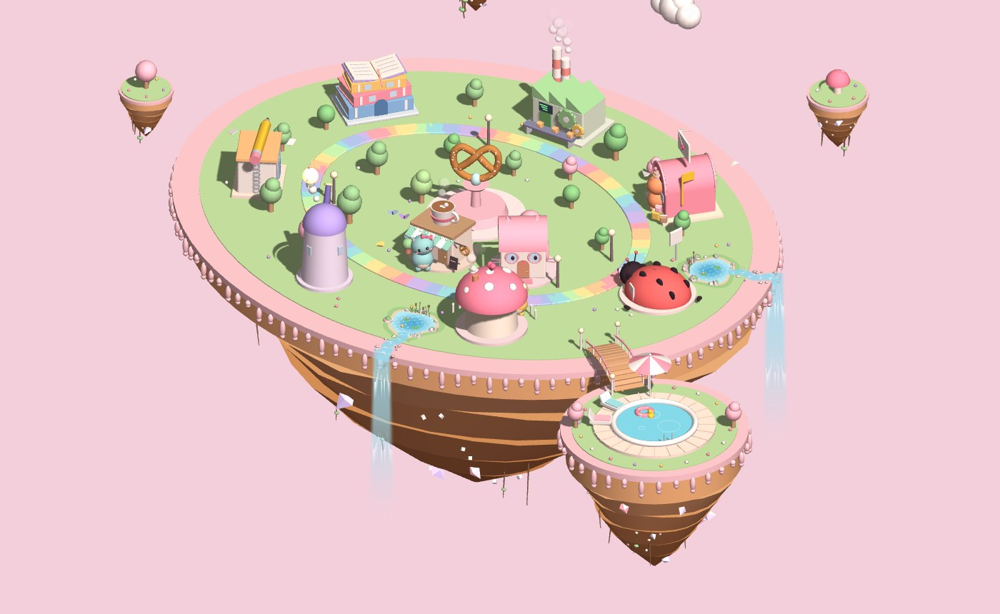
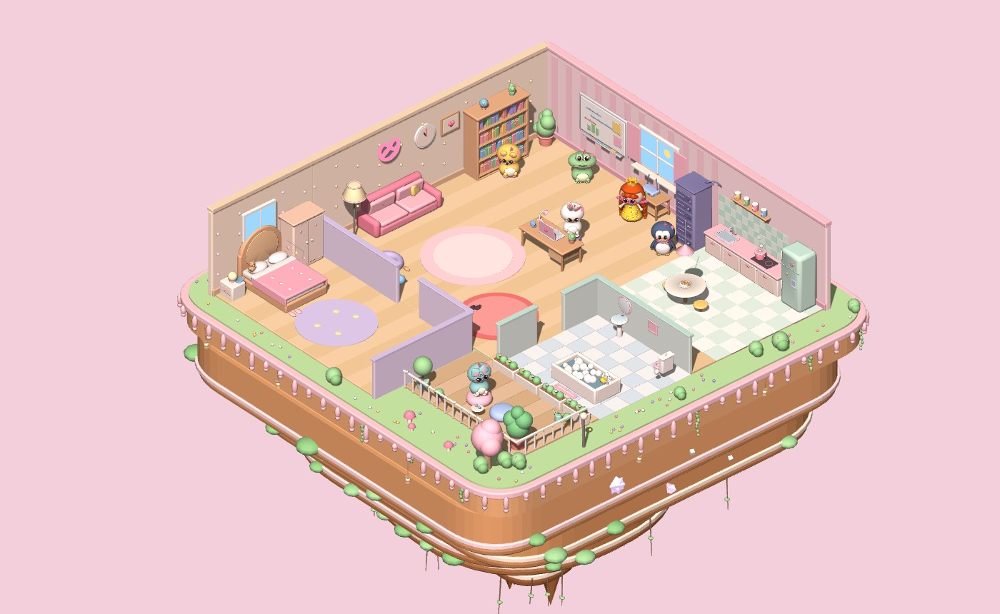
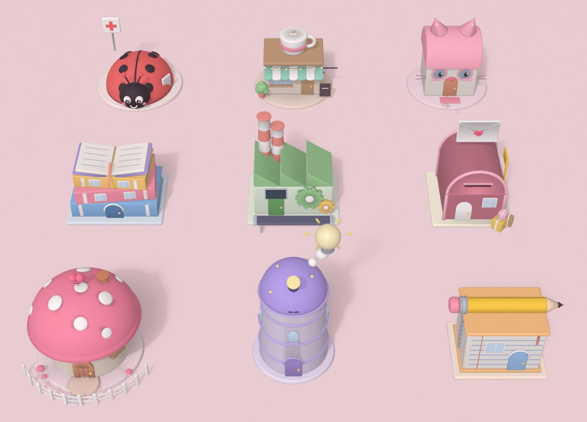

# 🥨 Miw's Town

A cozy, pastel 3D town and cat room that shows what your Claude Code agents are doing, live.

Each Claude Code session moves in as a little character. When it reads files it walks to the Library, when it edits it sits in the Writing Studio, and when something fails it ends up at the Bug Clinic. When it's done it heads home to rest, swim, or grab a pretzel at the café. Everything floats on golden pretzel-dough islands with pink icing.

## Two places

**The Town** (`/town`): a floating island with a rainbow road and one building per state. There's also a pool islet, the Pretzel Café, waterfalls, and the 🐱 Cat Home. Tap the Cat Home to go inside.



**The Cat Room** (`/room`): the same agents, indoors. It has a living room, kitchen, bathroom, bedroom, and a plant balcony, all floating on a little garden island.



| State | Town | Cat Room |
|---|---|---|
| 💤 Resting | Cozy Cottage, pool, Pretzel Café | Sofa, kitchen, bath, bed, balcony |
| 💭 Thinking | Thinking Tower | Whiteboard |
| ✏️ Writing | Writing Studio | Desk |
| 📚 Researching | Library | Bookshelf |
| ⚙️ Running | Code Factory | Server rack |
| 📮 Syncing | Post Office | Router nook |
| 🐞 Stuck | Bug Clinic | Bug rug |

## Sculpted in Blender

The characters, the town's buildings and the Cat Room's furniture are modelled in [Blender](https://www.blender.org), from Python scripts in `models/`, and exported as `.glb` files the pages load.




- **Soft and rounded.** Big heads, chubby bodies and bevelled edges everywhere, with ambient occlusion baked into each vertex, so creases and undersides go softly darker like a clay toy.
- **Animated in Blender too.** Every character has a walk cycle with a real stride, plus idle sways, ear twitches and blinks. Moving parts of buildings (the telescope dome, the pencil, the gears, the envelope sign) are named nodes the town animates.
- **Always something to show.** The pages draw their built-in shapes first and swap each model in as it loads, so they still work if a model is missing.
- **Light on the browser.** Each piece of furniture is fused into one mesh per color before export, so the room has far fewer meshes to draw.

To change a model, edit its script and rebuild. The scripts are tested with Blender 5.1 (set `BLENDER` if it isn't at `/Applications/Blender.app`):

```bash
sh models/build.sh            # everything
sh models/build.sh cat cafe   # just these
```

Characters are `models/<name>.py`; the buildings all come from `models/town.py` and the furniture from `models/room.py`. Shared helpers (rounded shapes, faces, the walk cycle, the shadow bake) live in `models/kit.py`.

## Features

- **Live from Claude Code hooks.** No polling of your terminal. Claude Code tells the town what it's doing.
- **Send tasks from the UI.** ✨ New task starts a headless Claude Code run in a folder you pick. You can also message an existing agent, which continues its conversation in a fork; your open window isn't touched. Tasks can read and edit files in that folder only: no shell commands, no web.
- **Play with your agents.** Tap one to pet it, rename it, or change its look. Models: cat, bunny, bear, frog, chick, penguin, and Miw. The card also shows a spinning 3D portrait, a timeline of today, and recent activity.
- **Heads-up alerts.** A little card pops up when a friend gets stuck, is waiting for you, or finishes; tap it to jump there. The tab title shows how many need you, and 🔔 turns on desktop notifications for when the tab is in the background.
- **Follow and photos.** 🎯 Follow keeps the camera on one friend as it walks around. 📸 Photo saves a framed picture of the scene, name tags included.
- **Levels and a wardrobe.** Agents earn XP as they work and rest. They unlock a bow (Lv 2), scarf (Lv 3), flower crown (Lv 5), party hat (Lv 7), and crown (Lv 10).
- **Real Bangkok time and weather.** Day and night follow Thai time. Clouds, rain, and storms follow the real weather from [Open-Meteo](https://open-meteo.com).
- **Festivals.** Halloween (Oct 24 – Nov 1) brings pumpkins, ghosts, bats, and witch hats.
- **Little touches.** Animated speech bubbles, friends waving when they meet, butterflies, a hot-air balloon, and optional ambient sound (🔇 by default). Tap any building or room to see who's there.

## Requirements

- [Node.js](https://nodejs.org) 18 or newer (no `npm install` needed; there are no dependencies)
- [Claude Code](https://claude.com/claude-code) logged in on the same machine (`claude` on your PATH, or set `CLAUDE_BIN`)
- A modern browser with WebGL

## Setup

1. **Start the server** from this folder:

   ```bash
   node server.js
   ```

   It prints `Miw's Town → http://localhost:19100`. Open that in your browser.

2. **Connect the hook.** Add `hook.js` to your Claude Code hooks in `~/.claude/settings.json`. `claude-settings-snippet.json` has the full block for all seven events (`SessionStart`, `UserPromptSubmit`, `PreToolUse`, `PostToolUseFailure`, `Notification`, `Stop`, `SessionEnd`). Replace `/path/to/MiwTown` with where you cloned this repo, and use the full path to `node` if hooks can't find it.

3. **Start a Claude Code session** anywhere. A new friend moves into town. 🎉

The hook gives up after 800 ms, so Claude Code is never slowed down if the town isn't running.

## Try things out

Add these to the URL:

| Parameter | What it does |
|---|---|
| `?hour=21` | Pretend it's 9 pm (any hour 0–23) |
| `?weather=rain` | Force the weather: `clear`, `cloudy`, `rain`, or `storm` |
| `?festival=halloween` | Turn a festival on (`?festival=none` turns it off) |

If the server isn't reachable, the page runs a demo with a few made-up agents.

## Configuration

| Environment variable | Default | Meaning |
|---|---|---|
| `AGENT_OFFICE_PORT` | `19100` | Port for the server and the hook |
| `CLAUDE_BIN` | `~/.local/bin/claude` or `claude` | The Claude Code binary used for tasks |

## Security

The server listens on `127.0.0.1` only, and:

- Only the hook can report state. `POST /state` must be JSON with no `Origin` header, so web pages can't plant fake agents.
- Starting tasks needs a secret token. The token is made fresh each run and only given to pages the server serves itself.
- Requests addressed to any other host name are refused, which blocks DNS-rebinding tricks.
- Task folders must be inside your home folder (and not the home folder itself). This applies to messages sent to existing agents too.
- At most 3 tasks run at once, and each stops after 30 minutes.

## Files

| File | What's in it |
|---|---|
| `server.js` | Tiny Node server: agent state, tasks, weather, serves the pages |
| `hook.js` | Claude Code hook that turns hook events into states |
| `town.html` | The 3D town |
| `room.html` | The 3D cat room |
| `panel.js` | Shared UI: task drawer, agent cards, wardrobe, timelines, places, festivals, sound, bubbles |
| `scenery.js` | Shared 3D bits: pretzels, floating islands, icing, and merging static scenery to keep it fast |
| `models.js` | Loads the Blender models, colors them per agent and plays their walk, idle and blink clips |
| `models/` | Blender scripts for the characters, buildings and furniture, the `.glb` files they make, and `build.sh` |
| `claude-settings-snippet.json` | Hook settings to paste into `~/.claude/settings.json` |

Built with [three.js](https://threejs.org) r128.
