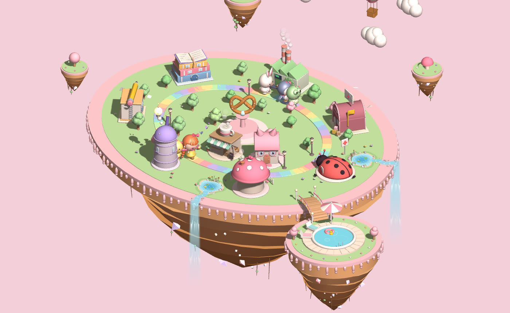
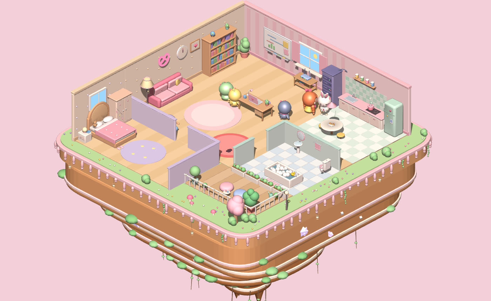
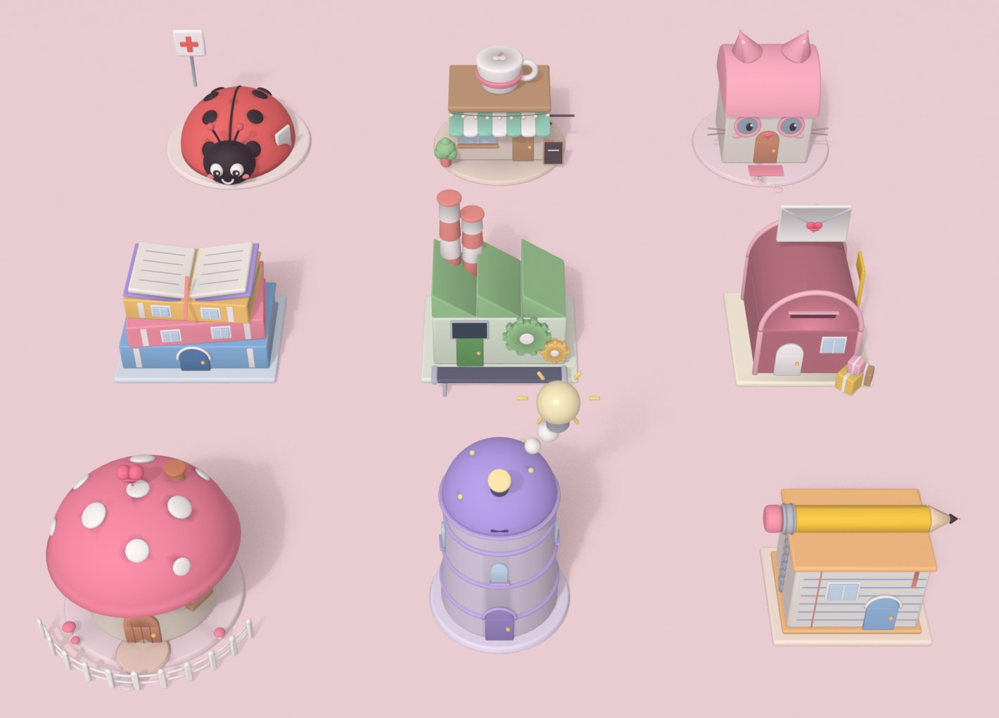
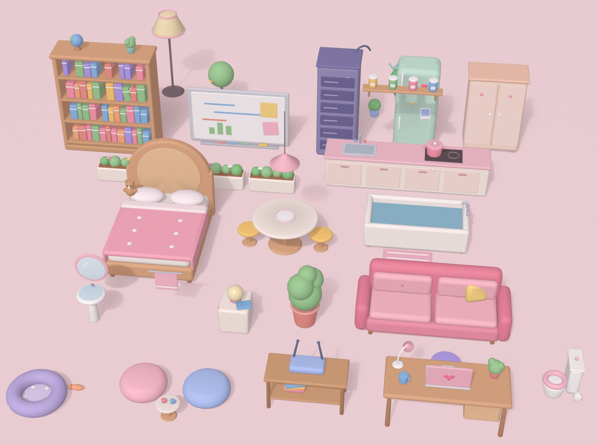
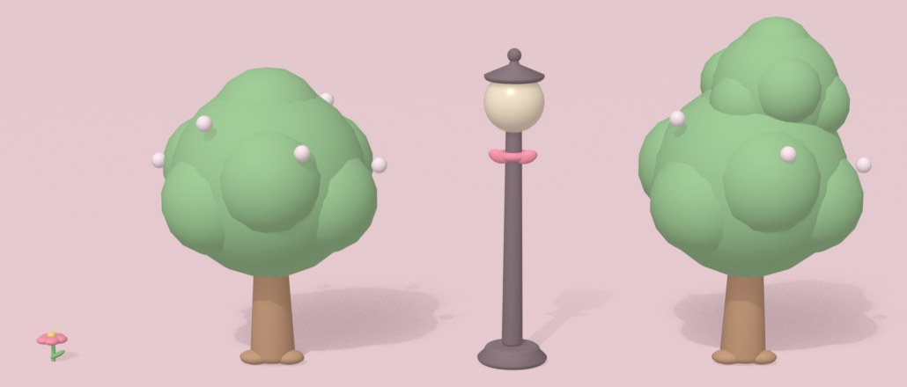
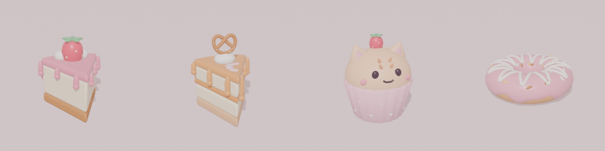

# 🥨 Miw's Town

A cozy, pastel 3D town and cat room that shows what your Claude Code agents are doing, live.

Each Claude Code session moves in as a little character. When it reads files it walks to the Library, when it edits it sits in the Writing Studio, and when something fails it ends up at the Bug Clinic. When it's done it heads home to rest, swim, or grab a pretzel at the café. Everything floats on golden pretzel-dough islands with pink icing.

## Two places

**The Town** (`/town`): a floating island with a rainbow road and one building per state. There's also a pool islet, the Pretzel Café, waterfalls, and the 🐱 Cat Home. Tap the Cat Home to go inside.



**The Cat Room** (`/room`): the same agents, indoors. It has a living room, kitchen, bathroom, bedroom, and a plant balcony, all floating on a little garden island.



| State | Town | Cat Room |
|---|---|---|
| 💤 Resting | Cozy Cottage, pool, Pretzel Café | Sofa, kitchen, bath, bed, balcony |
| 💭 Thinking | Thinking Tower | Whiteboard |
| ✏️ Writing | Writing Studio | Desk |
| 📚 Researching | Library | Bookshelf |
| ⚙️ Running | Code Factory | Server rack |
| 📮 Syncing | Post Office | Router nook |
| 🐞 Stuck | Bug Clinic | Bug rug |

## Cheesecake Rush

A cozy café game (`/game`, or 🍰 Cheesecake Rush in the town's toolbar) built on the same models. Friends sit down and order a dessert and often a drink. Miw serves them, they queue at the cashier, and you give the right change on a little calculator.

1. **Bake.** Before each day, and again when a shelf runs out, drag the ingredients into the bowl, stir in circles, take the cake out of the oven when the marker is in the green, and place the toppings. Better baking sells for more. Strawberries are picked from the café's strawberry plot.
2. **Serve.** Tap a dessert or drink to pick it up (two at a time), or tap a friend's table and Miw fetches everything they ordered. Quick service earns bigger tips.
3. **Cash up.** Friends pay with a note, exact money or QR. The right change on the first try earns the tip, the combo and a speed bonus.

Each day has a goal that climbs gently, with more tables and new desserts and drinks to unlock, and one to three stars. Every friend has a favorite and a quirk: the cat loves the Kitty Cupcake, some tip big, some are in a hurry. The home screen has three save slots (kept in this browser), how to play, settings and credits, and the whole game is in Thai when the language is set to ไทย.

## Sculpted in Blender

The characters, the town's buildings, the Cat Room's furniture and the little props dotted around the town are modelled in [Blender](https://www.blender.org), from Python scripts in `models/`, and exported as `.glb` files the pages load.










- **Little vinyl toys.** Big round heads on small bean bodies, small bead eyes set low and wide, a tiny w mouth (the frog smiles wide), rosy dot cheeks and a light pastel palette with a soft sheen. Each friend holds a slice of strawberry cheesecake, put away while it walks. The design was picked option by option from side-by-side renders.
- **Soft and rounded.** Bevelled edges everywhere, with a soft, rosy shadow baked into each vertex, so creases and undersides go gently darker without looking grubby.
- **Animated in Blender too.** Every character has a walk cycle with a real stride, plus idle sways, ear twitches and blinks. Moving parts of buildings (the telescope dome, the pencil, the gears, the envelope sign) are named nodes the town animates.
- **Always something to show.** The pages draw their built-in shapes first and swap each model in as it loads, so they still work if a model is missing.
- **Light on the browser.** Each piece of furniture is fused into one mesh per color before export, so the room has far fewer meshes to draw.

To change a model, edit its script and rebuild. The scripts are tested with Blender 5.1 (set `BLENDER` if it isn't at `/Applications/Blender.app`):

```bash
sh models/build.sh            # everything
sh models/build.sh cat cafe   # just these
```

Characters are `models/<name>.py`; the buildings all come from `models/town.py`, the furniture from `models/room.py`, the trees, flowers and lamp posts from `models/props.py` (one model each, recolored per copy), the game's desserts from `models/menu.py` (the cheesecake and pretzel cake also come whole, as `cheesefull` and `pretzelfull`, for the oven), and the intro video's cheesecake shop (the set, the giant cake and the hanging lamp) from `models/shop.py`. Shared helpers (rounded shapes, faces, the walk cycle, the shadow bake) live in `models/kit.py`.

## Features

- **Live from Claude Code hooks.** No polling of your terminal. Claude Code tells the town what it's doing.
- **Send tasks from the UI.** ✨ New task starts a headless Claude Code run in a folder you pick. You can also message an existing agent, which continues its conversation in a fork; your open window isn't touched. Tasks can read and edit files in that folder only: no shell commands, no web.
- **Play with your agents.** Tap one to pet it, rename it, or change its look. Models: cat, bunny, bear, frog, chick, penguin, and Miw. The card also shows a spinning 3D portrait, a timeline of today, and recent activity.
- **Heads-up alerts.** A little card pops up when a friend gets stuck, is waiting for you, or finishes; tap it to jump there. The tab title shows how many need you, and 🔔 turns on desktop notifications for when the tab is in the background.
- **Tidy the view.** 🏷️ Names, 💬 Bubbles and 🏠 Places hide or show the name tags, speech bubbles and the place labels over buildings and furniture.
- **Follow and photos.** 🎯 Follow keeps the camera on one friend as it walks around. 📸 Photo saves a framed picture of the scene, name tags included.
- **Levels and a wardrobe.** Agents earn XP as they work and rest. They unlock a bow (Lv 2), scarf (Lv 3), flower crown (Lv 5), party hat (Lv 7), and crown (Lv 10). The penguin keeps its own pink scarf instead of the Lv 3 one.
- **Real Bangkok time and weather.** Day and night follow Thai time. Clouds, rain, and storms follow the real weather from [Open-Meteo](https://open-meteo.com).
- **Little touches.** Animated speech bubbles, friends waving when they meet, butterflies, a hot-air balloon, and optional ambient sound (🔇 by default). Tap any building or room to see who's there.

## Requirements

- [Node.js](https://nodejs.org) 18 or newer (no `npm install` needed; there are no dependencies)
- [Claude Code](https://claude.com/claude-code) logged in on the same machine (`claude` on your PATH, or set `CLAUDE_BIN`)
- A modern browser with WebGL

## Setup

1. **Start the server** from this folder:

   ```bash
   node server.js
   ```

   It prints `Miw's Town → http://localhost:19100`. Open that in your browser. The game is at `/game`.

2. **Connect the hook.** Add `hook.js` to your Claude Code hooks in `~/.claude/settings.json`. `claude-settings-snippet.json` has the full block for all seven events (`SessionStart`, `UserPromptSubmit`, `PreToolUse`, `PostToolUseFailure`, `Notification`, `Stop`, `SessionEnd`). Replace `/path/to/MiwTown` with where you cloned this repo, and use the full path to `node` if hooks can't find it.

3. **Start a Claude Code session** anywhere. A new friend moves into town. 🎉

The hook gives up after 800 ms, so Claude Code is never slowed down if the town isn't running.

## Try things out

Add these to the URL:

| Parameter | What it does |
|---|---|
| `?hour=21` | Pretend it's 9 pm (any hour 0–23) |
| `?weather=rain` | Force the weather: `clear`, `cloudy`, `rain`, or `storm` |

If the server isn't reachable, the page runs a demo with a few made-up agents.

## Configuration

| Environment variable | Default | Meaning |
|---|---|---|
| `AGENT_OFFICE_PORT` | `19100` | Port for the server and the hook |
| `CLAUDE_BIN` | `~/.local/bin/claude` or `claude` | The Claude Code binary used for tasks |

## Security

The server listens on `127.0.0.1` only, and:

- Only the hook can report state. `POST /state` must be JSON with no `Origin` header, so web pages can't plant fake agents.
- Starting tasks needs a secret token. The token is made fresh each run and only given to pages the server serves itself.
- Requests addressed to any other host name are refused, which blocks DNS-rebinding tricks.
- Task folders must be inside your home folder (and not the home folder itself). This applies to messages sent to existing agents too.
- At most 3 tasks run at once, and each stops after 30 minutes.

## Files

| File | What's in it |
|---|---|
| `server.js` | Tiny Node server: agent state, tasks, weather, serves the pages |
| `hook.js` | Claude Code hook that turns hook events into states |
| `town.html` | The 3D town |
| `room.html` | The 3D cat room |
| `game.html` | Cheesecake Rush: the café, the kitchen, serving and the cashier |
| `home.js` | The game's home screen (save slots, how to play, settings, credits) and pause menu |
| `i18n.js` | The game's Thai translation, swapped in over the English text |
| `styletest.html` | Side-by-side looks tried for the café (`/style`) |
| `panel.js` | Shared UI: task drawer, agent cards, wardrobe, timelines, places, sound, bubbles |
| `scenery.js` | Shared 3D bits: pretzels, floating islands, icing, and merging static scenery to keep it fast |
| `models.js` | Loads the Blender models, colors them per agent and plays their walk, idle and blink clips |
| `models/` | Blender scripts for the characters, buildings, furniture, props and desserts, the `.glb` files they make, and `build.sh` |
| `claude-settings-snippet.json` | Hook settings to paste into `~/.claude/settings.json` |
| `video/` | The video studio: clip pages, the frame and sound capture server, the FFmpeg encoder and the Remotion 9:16 cut (see [Videos](#videos)) |

Built with [three.js](https://threejs.org) r128.

## Videos

`video/` is a little studio for cute clips made from code, using the same Blender characters. Each clip is one HTML page with a `renderAt(t)` that draws exactly time `t`, so every frame comes out the same every time.

```bash
node video/serve.js           # http://localhost:19200 plays the intro loop
```

- `?t=2.5` freezes on the frame at 2.5 seconds, handy for checking stills.
- `?capture` renders every frame into `video/out/<clip>/frames/`, and `?audio` renders its soundtrack to `video/out/<clip>/<clip>.wav`. Every sound is synthesized in code (`video/sound.js`) and timed from the same numbers as the animation.
- `sh video/encode.sh intro` then makes the MP4 for X (with the soundtrack mixed to -14 LUFS), a looping GIF, a contact sheet and a three-loop seam check (needs [FFmpeg](https://ffmpeg.org): `brew install ffmpeg`).
- For Reels, TikTok and Shorts, `cd video/remotion && npm install && npm run render` makes a 9:16 cut with [Remotion](https://www.remotion.dev): the loop twice, framed with a bouncy title and an end card (`video/out/intro/intro-vertical.mp4`).

**Meet the friends** (`video/intro.html`): a 10.5 s seamless loop, 1080×1080 at 30 fps. In Miw's Cheesecake shop, a giant strawberry cheesecake turns to bring each friend to the front, where it hops, spins and gets its name tag.

- **The set** is sculpted in Blender (`models/shop.py`): a window with a striped awning, a chalkboard sign, scalloped shelves of cheesecakes and jam, a cheesecake-wheel clock, bunting and hanging lamps.
- **Lit like a lens.** The shop behind is softly out of focus while the cake, the friends and the sign stay sharp, with a warm beam through the window, glowing lamps, a pink rim light and a gentle vignette.
- **Always something moving.** Steam curls from a cup of tea, sugar dust twinkles in the window light, clouds drift past and the clock's hand goes round. Everything repeats a whole number of times per loop, so the seam never shows.
- **The friends react.** The name tag pops in with GSAP, letter by letter; the others turn to watch, bounce when the hopper lands and sway as the cake turns.
- **Sound.** A music-box tune over soft chords, with a boing, a thump, a pop and little ticks for every hop and name tag, a whoosh as the cake turns and a shop bell, each one frame after its picture.

**Cheesecake Rush promo** (`video/rush.html`): a 21.2 s clip, 1080×1080 at 30 fps, with English captions. It doesn't loop; it plays through five scenes and a pink iris wipes between them.

1. **Title.** Miw drops onto the giant cheesecake and four desserts pop up round her under the chalkboard sign.
2. **Bake.** Ingredients fall into the bowl, the spoon stirs, the cake rises in the oven, toppings drop on and it is cut into four.
3. **Serve.** The friends order and Miw carries her tray from table to table.
4. **Cash up.** The calculator from the game's checkout: key in the change, press Enter, coins rain.
5. **End card.** The friends hop one after another and the title bounces in.

```bash
node video/serve.js                        # http://localhost:19200/rush
FADE=0.8 NOLOOP=1 sh video/encode.sh rush  # after ?capture and ?audio have saved the frames and the soundtrack
```

For Reels, TikTok and Shorts, `cd video/remotion && npm run render:rush` frames it for 9:16 (`video/out/rush/rush-vertical.mp4`): a bouncy title on top, the clip in a picture frame, and Bake, Serve and Cash up lighting up below as the clip reaches each part.
